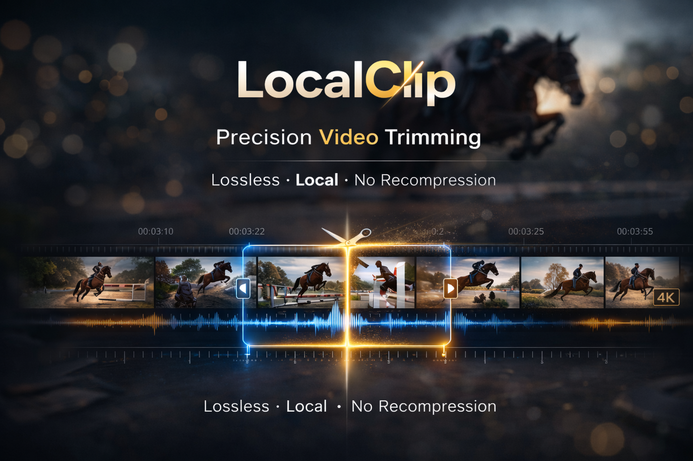

# 🎬 LocalClip

**Simple. Local. Yours.**

A lightweight video trimming tool for creators who want to prep clips quickly without uploading to the cloud.

---

## 🎯 What LocalClip Does

One job. Done right — the same tool as LocalClip on Android, laid out for a computer.

- **Open** one long video (the master) — or drop it on the window
- **Drag** the gold edges on the film strip, or press **Set IN** / **Set OUT**
- **Fine-tune** with ±60s … ±50ms buttons, or one frame at a time
- **Name** the clip and **save** it — original quality, nothing re-encoded
- **Cut the next one** — the master stays open

The start of a lossless clip snaps back to the nearest earlier keyframe; LocalClip tells you exactly where before you save. The end lands on the frame.

---

## ⬇️ Download

**https://the-artmedium.github.io/ImageStream/LocalClip/localclip.html**

- **Mac** (Apple chip): open the .dmg and drag LocalClip to Applications. The first time, go to System Settings → Privacy & Security → **Open Anyway**.
- **Windows 10 / 11**: run the Setup file. If "Windows protected your PC" appears, click **More info → Run anyway**.

One installer. Nothing else to install.

---

## ⌨️ Keys

- `Space` — play / pause
- `I` / `O` — set IN / OUT
- `←` `→` — one frame
- `Shift` + `←` `→` — one second
- `⌘S` / `Ctrl+S` — save the clip
- `⌘O` / `Ctrl+O` — open a video

Clips are saved to **Movies/LocalClip** (Videos/LocalClip on Windows) unless you choose another folder. An earlier clip is never overwritten.

Works in English, Español, Français, Português, العربية, 中文 and हिन्दी — following your computer's language.

---

## 🎨 Perfect For

- **Content Creators** - Quick clip prep for social media
- **Video Editors** - Fast rough cuts before fine editing
- **Podcasters** - Extract segments from long recordings
- **Teachers** - Pull clips from educational videos
- **Archivists** - Extract specific moments from footage

---

## 🤝 Works Great With

**LocalEdit** - After trimming clips with LocalClip, assemble them into complete videos with LocalEdit's 4-layer timeline.

**Your Workflow:**
1. Trim raw footage with **LocalClip**
2. Assemble clips in **LocalEdit**
3. Add music, text, graphics
4. Export final video
5. All offline. All yours.

---

## 🔧 System Requirements

- Mac with Apple chip (M1 or newer), or Windows 10 / 11 (64-bit)
- 4 GB RAM
- No internet needed

---

## 🌍 Philosophy

LocalClip is part of the **local-first creative toolkit**.

We believe:
- **Creators should own their tools**
- **Privacy is not a premium feature**
- **Simple tools do one job perfectly**
- **Offline capability is resilience**

In uncertain times, independence matters.

---

## ☕ Support

LocalClip is free: no ads, no tracking, no permissions it doesn't need.
If it helps your work, a coffee on Ko-fi keeps it going: **https://ko-fi.com/satdiva** — thank you!

---

## 📜 License

Free to use for everyone, for personal and professional work.
Not allowed without written permission: modifying it, redistributing it, or selling it — please share the official link instead: https://the-artmedium.github.io/ImageStream/
All rights reserved. See the [LICENSE](LICENSE) file. Contact: jeenajah@gmail.com

---

## 🙏 Contributing

Want to help make LocalClip better?

- Report bugs
- Suggest features
- Translate to new languages
- Improve documentation

Write to jeenajah@gmail.com. The code itself is not to be modified or redistributed.

---

## 💬 Community

- **GitHub Issues:** Bug reports and feature requests
- **Discussions:** Share your workflow and ideas

---

## 🎤 Built By

LocalClip was built in collaboration between a creator (human) and Claude (AI), demonstrating what's possible when humans and AI work together as partners, not replacements.

---

**Simple. Local. Yours.**

**Baperebup!** ✨

*LocalClip - Trim Locally, Create Freely*
