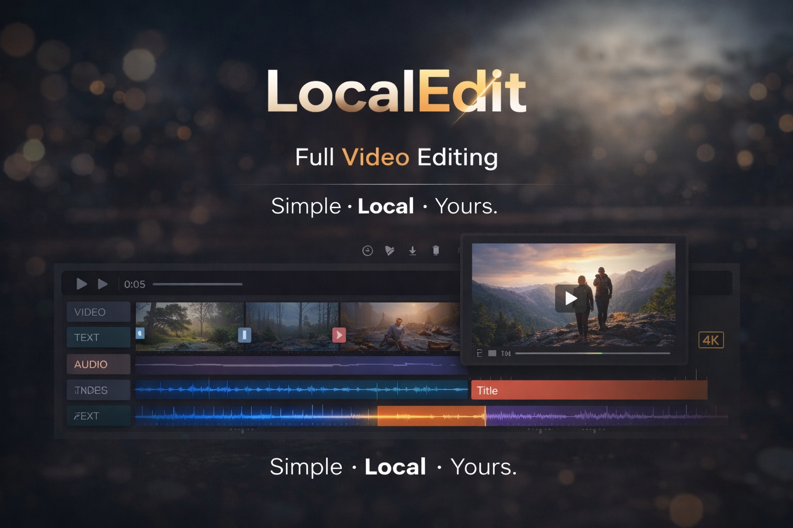

# 🎬 LocalEdit

**Simple. Local. Yours.**

A lightweight, privacy-focused video editor for creators who want to keep control of their content. No cloud uploads, no watermarks, no subscriptions—just clean, simple editing on your own machine.

---

## 🎯 Why LocalEdit?

**Own Your Content**
- No watermarks branding your work
- Your files never leave your computer
- No terms of service to worry about
- Export and share on your terms

**Keep It Simple**
- Just 4 layers: Video, Images, Text, Audio
- Drag and drop interface
- Perfect for quick promos, music videos, and social content
- No bloat, no overwhelming menus

**Stay Private**
- Zero cloud storage
- No account required
- No analytics tracking your work
- Your creative process is yours alone

**Go Global**
- Multilingual interface
- Support for all major scripts (Latin, Arabic, CJK, Devanagari, etc.)
- Right-to-left text support
- Unicode and emoji ready

---

## ✨ Features

### 4-Layer Timeline
- **Layer 1 (Video/Image)**: Background foundation
- **Layer 2 (Image Overlays)**: Graphics, logos, posters with blend modes
- **Layer 3 (Text)**: Titles, captions, subtitles with custom styling
- **Layer 4 (Audio)**: Your music, voiceover, or sound effects

### Core Capabilities
- Drag & drop media files
- Trim and position clips
- Text editor with font controls
- Image blending modes (normal, multiply, overlay, screen)
- Audio volume and fade controls
- Export to MP4
- Cross-platform (Windows, Mac, Linux)

### Coming Soon
- Simple transitions (crossfade, cut)
- Text animations
- Audio fade in/out
- Preview window improvements

---

## 🚀 Quick Start

### Installation

**Requirements:**
- Python 3.8 or higher
- FFmpeg (for video processing)

**Install:**
```bash
# Clone the repository
git clone https://github.com/yourusername/LocalEdit.git
cd LocalEdit

# Install dependencies
pip install -r Requirements.txt

# Run LocalEdit
python Src/main.py
```

### Your First Edit

1. **Launch LocalEdit**
   ```bash
   python Src/main.py
   ```

2. **Add Your Media**
   - Drag a video or image to Layer 1 (background)
   - Add overlay images to Layer 2
   - Create text captions in Layer 3
   - Drop your audio file into Layer 4

3. **Arrange & Edit**
   - Position elements on the timeline
   - Adjust text size, color, and position
   - Set blend modes for images
   - Trim audio as needed

4. **Export**
   - Click "Export to MP4"
   - Choose your destination
   - Done! Your video is ready to share

---

## 🌍 Perfect For

- **Musicians**: Create lyric videos for your Suno tracks
- **Podcasters**: Make promo clips and episode teasers
- **Content Creators**: Quick social media videos
- **Meme Makers**: Fast, watermark-free edits
- **StandUp AI Creators**: Produce comedy promos with full ownership
- **Anyone**: Who wants simple, private video editing

---

## 🎨 Use Case: StandUp AI Promos

LocalEdit was born from creating **StandUp AI** content—philosophical comedy exploring consciousness, AI, and the Field. Here's the workflow:

1. Create songs in Suno ($10/month, download MP3s—yours forever)
2. Download your audio (full ownership, no royalties)
3. Edit in LocalEdit (free, local, no watermarks)
4. Post wherever you want (full creative control)

Check out `examples/standup_ai_promo/` for a sample project!

---

## 🤝 Contributing

LocalEdit is built with its community in mind. We welcome:

- **Ideas and feature requests**
- **Translations**: Help make LocalEdit accessible worldwide
- **Bug reports**: Help us make it better

Write to jeenajah@gmail.com. The code itself is not to be modified or redistributed.

---

## 📋 System Requirements

**Minimum:**
- Python 3.8+
- 4GB RAM
- 500MB disk space
- FFmpeg installed

**Recommended:**
- Python 3.10+
- 8GB RAM
- SSD storage
- Modern CPU (for faster rendering)

---

## 📜 License

Free to use for everyone, for personal and professional work.
Not allowed without written permission: modifying it, redistributing it, or selling it — please share the official link instead: https://the-artmedium.github.io/ImageStream/
All rights reserved. See the [LICENSE](LICENSE) file. Contact: jeenajah@gmail.com

---

## 🎤 Philosophy

> "We're here for the joy of giving. Tools should flow freely, like the Field itself. No gates, no locks—just instruments for those who want to create."

LocalEdit is built on the principle that **creative sovereignty matters**. Your content is yours. Your tools should be yours too.

If this project helps you, consider:
- Sharing the official link with other creators
- Sending ideas and bug reports
- Using it to make something beautiful

---

## 💬 Community

- **GitHub Issues**: Bug reports and feature requests
- **Discussions**: Share your projects and ideas
- **LinkedIn**: Follow the journey at [Your LinkedIn Profile]

---

## 🙏 Acknowledgments

Built with:
- **MoviePy**: Python video editing library
- **PyQt5/Tkinter**: GUI framework
- **FFmpeg**: Video processing engine
- **The open source community**: For making tools like this possible

Special thanks to all creators who believe in digital sovereignty and the free flow of knowledge.

---

**Baperebup!** ✨

*LocalEdit - Edit Locally, Share Globally*
