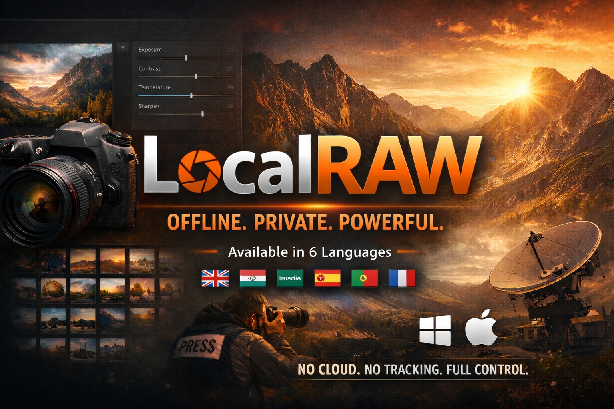

# LocalRAW

Cull and edit a whole shoot, RAW or JPG, on your own computer.
No cloud. No subscriptions. No uploads. Your photos stay on your machine.

**Download:** https://the-artmedium.github.io/ImageStream/LocalRAW/localraw.html
— Mac (Apple chip) and Windows 10 / 11. One installer, nothing else to install.

---

## 🌍 Why

Made for photographers working in low-bandwidth regions, rural areas, fast press
and broadcast environments, independent journalism and sports — where there is
no time and no connection to waste.

---

## ✨ What it does

- **Focus Check** — sorts every photo into In focus, Fixable or Rejected, judged on the faces
- **You have the last word** — keys G / Y / R or right-click move a photo to another group
- **Stars** (keys 1–5), filters, and the best frame of each burst
- **White balance** — Pick Neutral and Auto Neutral; **Auto Tone**; tone and detail controls
- **Noise reduction** measured per photo, for high ISO
- **Crop** in common shapes and **straighten**
- **Loupe**, focus **peaking** and 100 % zoom
- **Keep edit / Last Edit** — the same look on the next photos
- **Save** a full-size JPEG copy, or **Export** many photos Lightroom-style
- Originals are never changed · works fully offline · 7 languages

RAW: CR2, CR3, NEF, ARW, DNG, RAF, ORF and more — plus JPG, PNG and TIFF.

---

## 📄 License

Free to use for everyone, for personal and professional work.
Not allowed without written permission: modifying it, redistributing it, or selling it —
please share the official link instead: https://the-artmedium.github.io/ImageStream/
All rights reserved. See the [LICENSE](LICENSE) file. Contact: jeenajah@gmail.com
