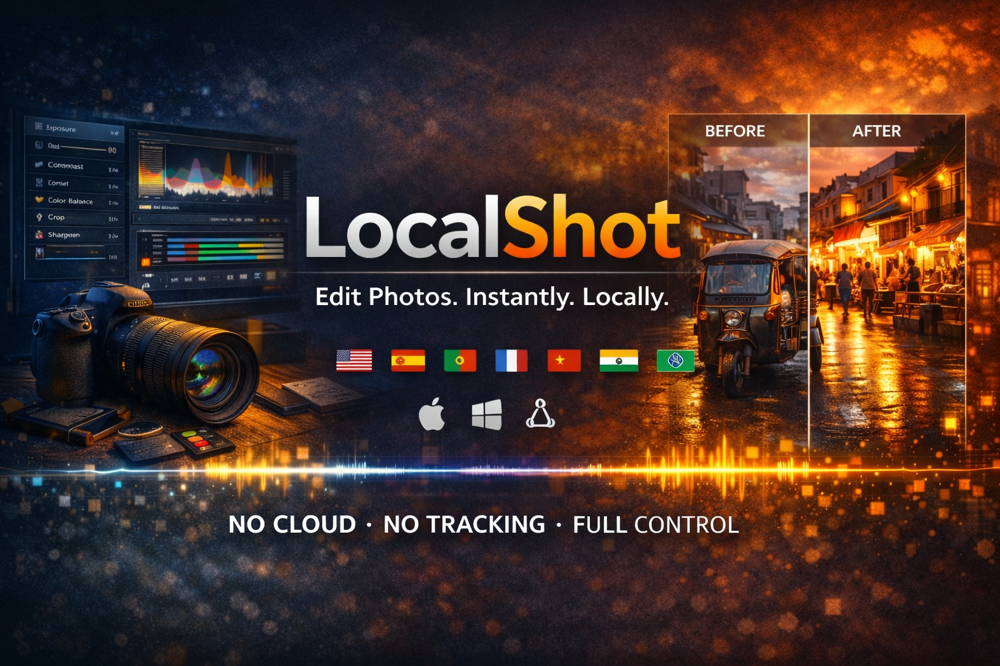

# 📸 LocalShot

**Image Editor for Everyone**
Part of the ImageStream Local Suite by The Art Medium

Simple. Offline. Private. Yours.

---

## Features

- 📁 Open folder — browse all images as thumbnails, the current photo is highlighted
- ◀ ▶ Previous / Next (arrow keys), with the photo name and "3 of 20" always visible
- 🔍 Zoom — Fit, 100%, mouse wheel, double-click, drag to move around
- 🎯 Focus Check — scores every photo: sharp, fixable or rejected; filter by group
- 🩹 Recover Sharpness, with a Before | After split view
- 🗑 Delete to the Trash (one photo, or all rejected), always with a confirmation
- ☀️ Simple / Advanced mode toggle
- **Basic:** Brightness, Contrast, Exposure
- **Advanced Tone:** Whites, Blacks
- **Color:** White Balance (Temperature + Tint)
- **Detail:** Sharpening, Dehaze
- ✂️ Crop by dragging
- ⊞ Resize
- ↺↻ Rotate & Flip
- 💾 Export — JPG, PNG, WebP, BMP, TIFF (camera data is kept)
- 🌍 7 languages — English, Español, Français, Português, العربية, 中文, हिन्दी

---

## Install

Nothing else to install. Download one file and open it:

**[Download LocalShot](https://github.com/The-ArtMedium/ImageStream/releases/tag/localshot-latest)**

- **Windows:** `LocalShot-Setup.exe`
- **Mac (Apple Silicon):** `LocalShot-macOS.dmg`, then drag LocalShot to Applications

Your computer may show a security warning the first time, because the app is not
yet signed with Apple or Microsoft. On Mac: System Settings → Privacy & Security →
Open Anyway. On Windows: More info → Run anyway.

---

## License

Free to use for everyone, for personal and professional work.
Not allowed without written permission: modifying it, redistributing it, or selling it.
All rights reserved. See the LICENSE file.

---

No cloud. No account. No tracking. Free forever.

*Part of the ImageStream Local Suite — The Art Medium*
